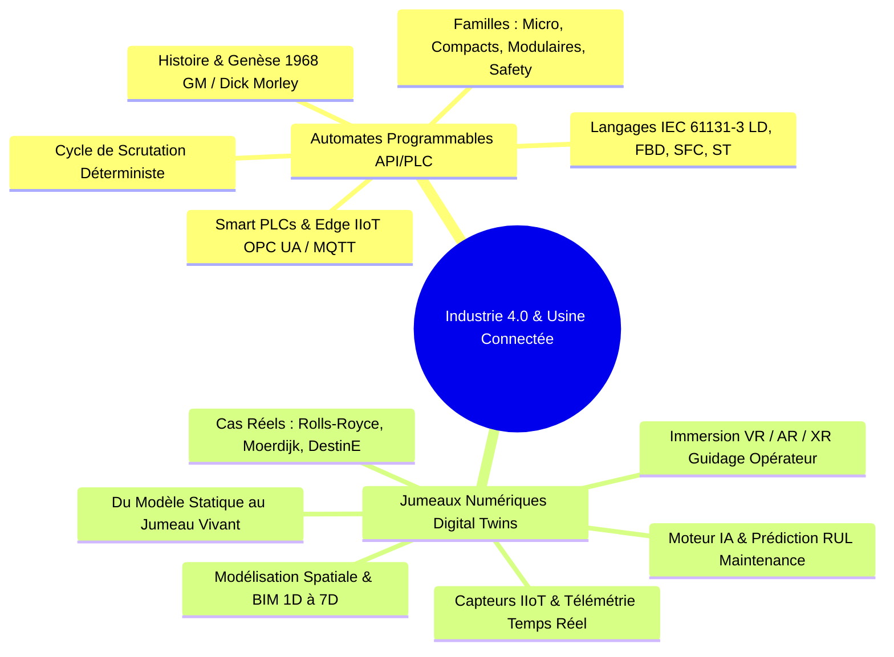

<div align="center">

# 🏭 Industry 4.0 Talks & Technical Presentations
### *Portfolio de Conférences & Livres Blancs Techniques : Automates Industriels & Jumeaux Numériques*

[](https://git.io/typing-svg)

<p align="center">
  
  
  
  
  
</p>

---

</div>

## 📖 Introduction & Vision Globale

Ce dépôt rassemble un **portfolio de présentations techniques exécutives et d'analyses approfondies** dédiées aux piliers majeurs de la **Transformation Digitale Industrielle** et de l'**Industrie 4.0**.

Chaque dossier comprend :
* Une **présentation technique complète** au format PowerPoint (`.pptx`), enrichie de schémas industriels, données réelles et études de cas.
* Un **livre blanc / README dédié** agissant comme une référence technique autonome avec définitions, architectures Mermaid, classifications matérielles et sources officielles internationales.



---

## 🗂️ Sommaire du Portfolio

```
industry-4-0-talks-and-presentations/
├── README.md                                          # Présentation globale du portfolio
├── .gitignore                                         # Règles d'exclusion des fichiers temporaires
│
├── automates-programmables-industriels/               # MODULE 1
│   ├── README.md                                      # Guide technique complet sur les PLCs (IEC 61131-3)
│   └── les_generations_des_automates.pptx             # Support de présentation (39 slides - 48.1 Mo)
│
└── jumeaux-numeriques-digital-twins/                  # MODULE 2
    ├── README.md                                      # Guide technique complet sur les Digital Twins (ISO 23247)
    └── Presentation_Digital_Twins_VR_AR.pptx          # Support de présentation HD (23 slides - 75.3 Mo)
```

---

## 📦 Détail des Présentations

### ⚡ Module 1 : Les Automates Programmables Industriels (API / PLC)
> **De la Logique Câblée aux Smart PLCs & à l'Automatisation Connectée**

* 📁 **Dossier :** [`automates-programmables-industriels/`](./automates-programmables-industriels/)
* 📄 **Livre Blanc & Documentation :** [Consulter le README dédié](./automates-programmables-industriels/README.md)
* 📥 **Support :** [`les_generations_des_automates.pptx`](./automates-programmables-industriels/les_generations_des_automates.pptx) *(48,1 Mo — 39 Diapositives)*
* **Points Clés Abordés :**
  * Genèse historique : du cahier des charges de General Motors (1968) et du Modicon 084 de Dick Morley jusqu'aux automates modernes.
  * Déterminisme temporel et cycle de scrutation en 5 étapes (Diagnostic $\rightarrow$ Lecture Entrées $\rightarrow$ Programme $\rightarrow$ Écriture Sorties $\rightarrow$ Communication).
  * Panorama des gammes du marché : Relais programmables (*Siemens LOGO!*), Compacts (*Schneider Modicon M221*), Modulaires (*Modicon M340/M580, Siemens S7-1500*).
  * Systèmes instrumentés de sécurité : Automates Safety (*SIL 3 / PL e, CEI 61508 / ISO 13849-1*).
  * Les 5 langages de la norme internationale **IEC 61131-3** (*LD, FBD, SFC, ST, IL*).
  * Évolution vers les Smart PLCs, l'Edge Computing et les protocoles IoT industriels (*OPC UA, MQTT*).

---

### 🌐 Module 2 : Les Jumeaux Numériques (Digital Twins) & Immersion VR/AR
> **Répliquer le Monde Réel : De la Simulation Statique au Jumeau Vivant et Connecté**

* 📁 **Dossier :** [`jumeaux-numeriques-digital-twins/`](./jumeaux-numeriques-digital-twins/)
* 📄 **Livre Blanc & Documentation :** [Consulter le README dédié](./jumeaux-numeriques-digital-twins/README.md)
* 📥 **Support :** [`Presentation_Digital_Twins_VR_AR.pptx`](./jumeaux-numeriques-digital-twins/Presentation_Digital_Twins_VR_AR.pptx) *(75,3 Mo — 23 Diapositives HD)*
* **Points Clés Abordés :**
  * Clarification conceptuelle rigoureuse : *Modèle Digital* (statique) $\rightarrow$ *Ombre Numérique* (flux temps réel unidirectionnel) $\rightarrow$ *Jumeau Numérique* (boucle fermée cyber-physique bidirectionnelle).
  * Les 4 piliers technologiques : Capteurs & IIoT (*les Sens*), Modélisation 3D & BIM (*le Squelette*), IA & Simulation Multiphysique (*le Cerveau*), Réseaux 5G & Réalité Virtuelle/Augmentée (*le Système Nerveux*).
  * La modélisation **BIM du 1D au 7D** (accent sur le BIM 7D : Facility Management, maintenance prédictive et durabilité).
  * Scalabilité multi-échelles : du composant mécanique unitaire (aube de réacteur) jusqu'à la Terre entière (*Destination Earth de l'ESA*).
  * Études de cas concrets : **Rolls-Royce** (modèle *Power by the Hour*), **Pont Moerdijk** (surveillance de fatigue des structures métalliques), **Smart Cities** (gestion de crise et mobilité intelligente) et santé biomédicale.

---

## ⚖️ Matrice Comparative des Deux Piliers

| Critère | Module 1 : Automates Industriels (API) | Module 2 : Jumeaux Numériques (Digital Twins) |
| :--- | :--- | :--- |
| **Niveau Pyramide CIM / ISA-95** | Niveau 1 & 2 (Contrôle-Commande direct & Supervision) | Niveau 3, 4 & Cloud (Optimisation globale & Simulation) |
| **Échelle Temporelle** | Millisecondes ($1\text{ ms} - 20\text{ ms}$, temps réel dur) | Secondes, Heures, Années (temps réel doux & prédictif) |
| **Finalité Principale** | Pilotage robuste et sécurisé des actionneurs physiques | Anticipation des pannes, optimisation du cycle de vie & aide à la décision |
| **Standard de Référence** | **IEC 61131-3** & **IEC 62443** (Cybersécurité OT) | **ISO 23247** & **openBIM / IFC** |
| **Technologies Clés** | Logiciels constructeurs (EcoStruxure, TIA Portal), E/S TOR/ANA | IoT, Big Data, IA (Machine Learning), Moteurs 3D/XR |

---

## 📚 Références & Sources Officielles

| Organisation | Domaine | Lien Officiel |
| :--- | :--- | :---: |
| **IEC (Commission Électrotechnique Internationale)** | Norme IEC 61131-3 (Automates) & IEC 62443 (Cybersécurité OT) | [iec.ch](https://www.iec.ch/) |
| **ISO (Organisation Internationale de Normalisation)** | Norme ISO 23247 (Cadre de référence des Jumeaux Numériques) | [iso.org](https://www.iso.org/) |
| **Digital Twin Consortium (DTC)** | Références d'architectures & terminologie des Digital Twins | [digitaltwinconsortium.org](https://www.digitaltwinconsortium.org/) |
| **buildingSMART International** | Standards ouverts openBIM, formats IFC & BCF | [buildingsmart.org](https://www.buildingsmart.org/) |
| **Schneider Electric** | Guides de conception automatismes Modicon & EcoStruxure | [se.com](https://www.se.com/) |
| **Siemens Industrial Automation** | Systèmes d'automatisation SIMATIC S7 & TIA Portal | [siemens.com](https://www.siemens.com/) |
| **European Space Agency (ESA)** | Initiative Destination Earth (DestinE) | [esa.int](https://www.esa.int/) |

---

## 👤 Auteur & Signature

<div align="center">

**Imad EL ADES (iM@Des)**  
*Ingénieur en Transformation Digitale Industrielle*  

[](https://github.com/imad-elades)
[](https://github.com/imad-elades)

*Co-auteurs académiques :*
* *Automates Programmables Industriels :* Imad EL ADES & Haytame EL ATRAOUI
* *Jumeaux Numériques :* Imad EL ADES & N'Guemawen N'DJINILA

---
*Ce référentiel technique est mis à disposition pour la formation, la recherche et l'illustration des architectures de l'Industrie 4.0.*
</div>
