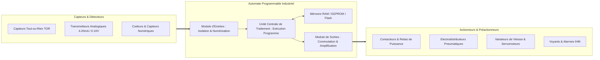
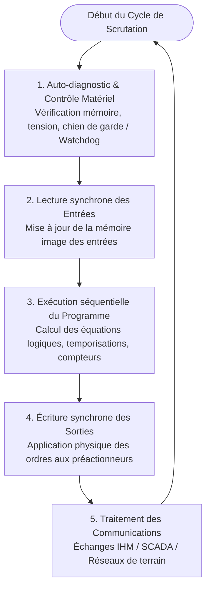

<div align="center">

# ⚡ Les Automates Programmables Industriels (API / PLC)
### *De la Logique Câblée aux Smart PLCs & à l'Automatisation Connectée (Industrie 4.0)*

[;Architecture+Mat%C3%A9rielle+%26+Cycle+de+Scrutation;Familles+d'Automates+%3A+LOGO!%2C+M221%2C+M340%2C+M580;Safety+PLCs+(SIL3%2FPLe)+%26+Smart+PLCs+(OPC-UA%2C+MQTT);Standard+International+IEC+61131-3)](https://git.io/typing-svg)

<p align="center">
  
  
  
  
</p>

<p align="center">
  <a href="./les_generations_des_automates.pptx">
    
  </a>
</p>

---

</div>

## 📑 Table des Matières

- [1. Vue d'Ensemble & Objectifs](#1-vue-densemble--objectifs)
- [2. Qu'est-ce qu'un API ? (Définition & Rôle)](#2-quest-ce-quun-api--définition--rôle)
- [3. Architecture Interne & Cycle de Fonctionnement](#3-architecture-interne--cycle-de-fonctionnement)
- [4. Histoire & Évolution Chronologique (1968 – Aujourd'hui)](#4-histoire--évolution-chronologique-1968--aujourdhui)
- [5. Classification & Familles d'Automates](#5-classification--familles-dautomates)
- [6. Les Langages de Programmation Normalisés (IEC 61131-3)](#6-les-langages-de-programmation-normalisés-iec-61131-3)
- [7. Vers l'Industrie 4.0 : Smart PLCs, IIoT & Cybersécurité](#7-vers-lindustrie-40--smart-plcs-iiot--cybersécurité)
- [8. Références & Sources Officielles](#8-références--sources-officielles)
- [9. Auteurs](#9-auteurs)

---

## 1. Vue d'Ensemble & Objectifs

Cette présentation technique approfondie (39 diapositives) retrace l'épopée technologique des **Automates Programmables Industriels (API)** — ou *Programmable Logic Controllers (PLC)*. De l'élimination des armoires à relais encombrantes dans l'industrie automobile jusqu'aux contrôleurs cyber-physiques de l'Usine du Futur communicant en **OPC UA** et **MQTT**, ce travail détaille :

* Les fondements matériels et temporels du fonctionnement déterministe en temps réel.
* La typologie complète des gammes industrielles (*Relais intelligents, Compacts, Modulaires, Safety, Edge Controllers*).
* Les 5 langages normalisés de la norme internationale **IEC 61131-3**.
* La convergence IT/OT et les exigences de sûreté de fonctionnement (SIL / PL).

---

## 2. Qu'est-ce qu'un API ? (Définition & Rôle)

Un **Automate Programmable Industriel (API)** est un équipement électronique robuste conçu pour opérer dans des environnements industriels sévères (vibrations, poussières, variations thermiques, perturbations électromagnétiques). 

Il exécute en boucle fermée et de manière déterministe un algorithme de contrôle-commande programmé en mémoire pour piloter des actionneurs à partir de l'état de capteurs.



---

## 3. Architecture Interne & Cycle de Fonctionnement

Contrairement à un ordinateur grand public polyvalent, un API exécute son traitement selon un **cycle de scrutation synchrone et périodique**, garantissant un temps de cycle maîtrisé (déterminisme temporel) :



* **Temps de cycle typique :** de $1\text{ ms}$ à $20\text{ ms}$ selon la complexité logicielle et le volume d'E/S.
* **Sécurité Watchdog :** Si le temps de cycle dépasse un seuil paramétré, l'API se met immédiatement en état de repli sécurisé (*Fail-Safe*).

---

## 4. Histoire & Évolution Chronologique (1968 – Aujourd'hui)

| Époque | Événement Clé | Avancée Technologique | Impact Industriel |
| :---: | :--- | :--- | :--- |
| **1968** | **Cahier des charges General Motors (GM)** | Demande de remplacement des relais électromécaniques | Réduction drastique des délais de reconfiguration des lignes |
| **1969** | **Modicon 084 (Dick Morley)** | Premier automate programmable commercialisé | Naissance du terme *Modular Digital Controller* (Modicon) |
| **1970's** | **Allen-Bradley & Odo Struger** | Dépôt du terme officiel **PLC** (*Programmable Logic Controller*) | Standardisation de la logique à relais graphique (*Ladder*) |
| **1980's** | **Arrivée des PC industriels** | Les consoles propriétaires cèdent la place aux logiciels PC | Édition conviviale et sauvegarde sur disquettes |
| **1990's** | **Normalisation IEC 61131-3 & Bus de terrain** | Standardisation des 5 langages + Profibus, Modbus, FIP | Interopérabilité logicielle et baisse des coûts de câblage |
| **2010's** | **Safety PLCs & Convergence Ethernet** | Automates redondants SIL 3 / PLe (ProfiSafe, CIP Safety) | Zéro compromis sur la sécurité des personnes et machines |
| **Aujourd'hui** | **Smart PLCs, Edge & IIoT** | Intégration native de serveurs OPC UA, MQTT, Linux embarqué | Télémaintenance sécurisée, Edge Computing & maintenance prédictive |

---

## 5. Classification & Familles d'Automates

```
                          FAMILLES D'AUTOMATES INDUSTRIELS
                                         │
     ┌───────────────────┬───────────────┴───────────────┬───────────────────┐
     ▼                   ▼                               ▼                   ▼
[Relais Logiques]   [Compacts Monoblocs]        [Modulaires Haut de Gamme]  [Safety PLCs]
(Ex: Siemens LOGO!)  (Ex: Modicon M221)          (Ex: Modicon M580, S7-1500) (Ex: GuardLogix)
     │                   │                               │                   │
  Petit tertiaire     Machines autonomes             Usines entières      Process critiques
  10 à 40 E/S         20 à 100 E/S                   Jusqu'à 10 000+ E/S   Norme ISO 13849 / SIL3
```

### 1. Relais Logiques Programmables (Micro-automates)
* **Exemple de référence :** *Siemens LOGO! 8, Zelio Logic*.
* **Usage :** Domotique tertiaire, automatismes d'éclairage, petites pompes, barrières de parking.
* **Caractéristiques :** Écran LCD et boutons intégrés en façade, faible coût, programmation directe ou via logiciel simplifié.

### 2. Automates Compacts (Monoblocs)
* **Exemple de référence :** *Schneider Electric Modicon M221, Omron CP1L*.
* **Usage :** Machines d'emballage, convoyeurs autonomes, bancs de test.
* **Caractéristiques :** Alimentation, CPU et bornier d'E/S regroupés dans un même boîtier mécanique.

### 3. Automates Modulaires
* **Exemple de référence :** *Schneider Electric Modicon M340 / M580 (ePAC), Siemens SIMATIC S7-1200 / S7-1500*.
* **Usage :** Lignes de production complètes, agroalimentaire, chimie, traitement des eaux, automobile.
* **Caractéristiques :** Châssis (rack) avec cartes interchangeables à chaud (CPU, cartes d'E/S TOR et analogiques, coupleurs de communication, cartes d'axes).

### 4. Automates de Sécurité (Safety PLCs)
* **Exemple de référence :** *Pilz PNOZmulti, Siemens S7-1500F (Fail-safe), Rockwell GuardLogix*.
* **Usage :** Barrières immatérielles, arrêts d'urgence, cellules robotisées, presses d'emboutissage.
* **Caractéristiques :** Architecture matérielle redondante (processeurs 1oo2D ou 2oo3), conformité **SIL 3 (CEI 61508)** et **PL e (ISO 13849-1)**.

### 5. Smart PLCs & Contrôleurs Edge (Industrie 4.0)
* **Exemple de référence :** *Phoenix Contact PLCnext, WAGO PFC200, Siemens S7-1500 avec Edge Module*.
* **Caractéristiques :** Double cœur IT/OT, conteneurisation Docker embarquée, protocoles natifs IoT (**MQTT, REST, OPC UA**), passerelle Cloud directe.

---

## 6. Les Langages de Programmation Normalisés (IEC 61131-3)

La norme internationale **CEI/IEC 61131-3** unifie le développement des automatismes à travers 5 langages :

| Langage | Type | Description & Cas d'Usage Idéal |
| :--- | :---: | :--- |
| **LD** (*Ladder Diagram*) | Graphique | Schéma à contacts directement hérité des schémas électriques à relais. Idéal pour la logique combinatoire TOR simple. |
| **FBD** (*Function Block Diagram*) | Graphique | Boîtes fonctionnelles interconnectées par des flux de signaux. Très utilisé pour la régulation PID et le traitement de signal. |
| **SFC** (*Sequential Function Chart / Grafcet*) | Graphique | Modélisation séquentielle par Étapes, Transitions et Actions. Idéal pour décrire les cycles de fonctionnement des machines. |
| **ST** (*Structured Text*) | Textuel | Langage structuré de haut niveau proche du Pascal/C. Indispensable pour les calculs mathématiques, boucles et algorithmes complexes. |
| **IL** (*Instruction List*) | Textuel | Langage de bas niveau de type assembleur *(déprécié dans la 3ᵉ édition de la norme en faveur du ST)*. |

---

## 7. Vers l'Industrie 4.0 : Smart PLCs, IIoT & Cybersécurité

Dans le paradigme de l'Usine Intelligente, l'automate ne se contente plus d'exécuter son programme local :

* **Interconnectivité Verticale :** Du capteur intelligent (**IO-Link**) jusqu'aux plateformes Cloud (AWS IoT, Azure IoT, MindSphere) en passant par le MES et l'ERP.
* **Norme ISA-95 & RAMI 4.0 :** Aplatissement de la pyramide d'automatisation traditionnelle grâce au bus universel **OPC Unified Architecture (OPC UA)**.
* **Cybersécurité Industrielle (IEC 62443) :** Chiffrement des communications, authentification par certificats X.509, désactivation des services non sécurisés (HTTP, Telnet) et pare-feu industriels embarqués.

---

## 8. Références & Sources Officielles

| Organisme / Fabricant | Référence / Norme | Lien Officiel |
| :--- | :--- | :---: |
| **IEC (CEI)** | *IEC 61131-3: Programmable controllers - Part 3: Programming languages* | [iec.ch](https://www.iec.ch/) |
| **IEC (CEI)** | *IEC 62443: Security for industrial automation and control systems* | [iec.ch](https://www.iec.ch/) |
| **Schneider Electric** | *Modicon PACs & PLCs Automation Guide (M221, M340, M580)* | [se.com](https://www.se.com/) |
| **Siemens** | *SIMATIC S7 Industrial Automation Systems Documentation & TIA Portal* | [siemens.com](https://www.siemens.com/) |
| **Rockwell Automation** | *Allen-Bradley ControlLogix & CompactLogix System User Manuals* | [rockwellautomation.com](https://www.rockwellautomation.com/) |
| **PLCopen** | *PLCopen International Standards for Industrial Control Programming* | [plcopen.org](https://plcopen.org/) |

---

## 9. Auteurs

* **Imad EL ADES (iM@Des)** — *Ingénieur en Transformation Digitale Industrielle* ([@imad-elades](https://github.com/imad-elades))
* **Haytame EL ATRAOUI** — *Élève Ingénieur en Génie Industriel*
