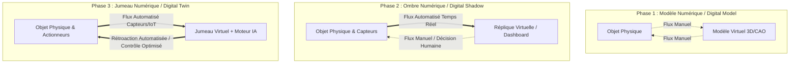
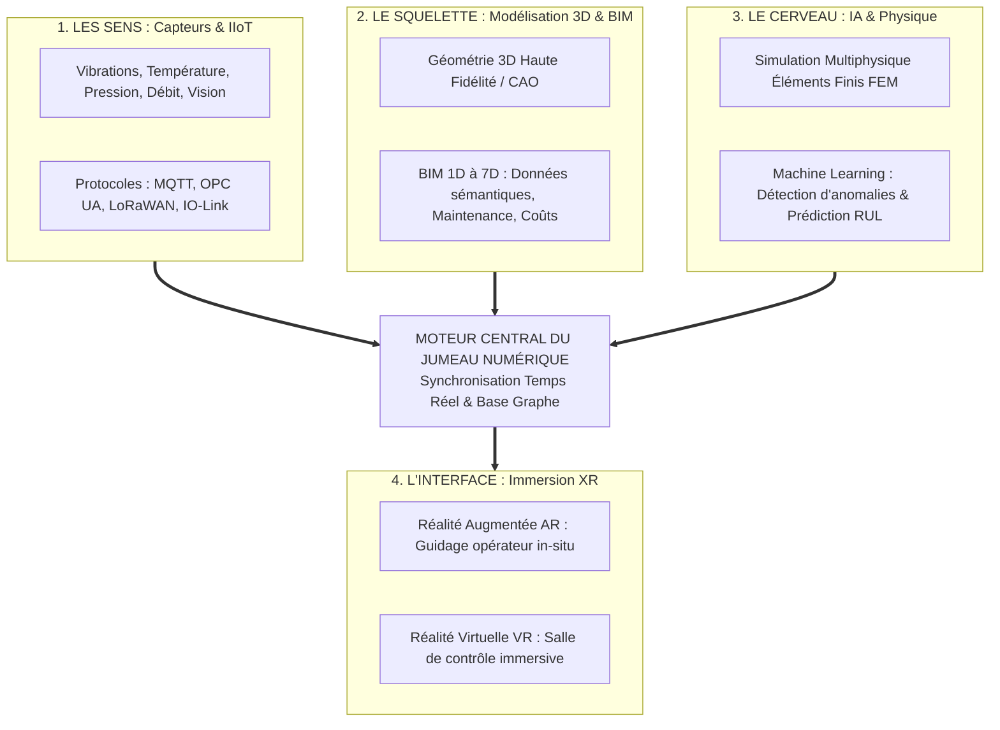

<div align="center">

# 🌐 Les Jumeaux Numériques (Digital Twins) & Réalité Virtuelle / Augmentée
### *Répliquer le Monde Réel : De la Simulation Statique au Jumeau Vivant et Connecté (Industrie 4.0)*

[;Cas+R%C3%A9els+%3A+Rolls-Royce%2C+Pont+Moerdijk%2C+Smart+Cities%2C+Sant%C3%A9;Standard+International+ISO+23247+%26+Digital+Twin+Consortium)](https://git.io/typing-svg)

<p align="center">
  
  
  
  
  
</p>

<p align="center">
  <a href="./Presentation_Digital_Twins_VR_AR.pptx">
    
  </a>
</p>

---

</div>

## 📑 Table des Matières

- [1. Vue d'Ensemble & Problématique](#1-vue-densemble--problématique)
- [2. L'Évolution Conceptuelle : Du Modèle Statique au Jumeau Vivant](#2-lévolution-conceptuelle--du-modèle-statique-au-jumeau-vivant)
- [3. Définition Formelle d'un Jumeau Numérique](#3-définition-formelle-dun-jumeau-numérique)
- [4. L'Écosystème Technologique (Les 4 Piliers)](#4-lécosystème-technologique-les-4-piliers)
  - [Pilier 1 : Les « Sens » (Capteurs & IIoT)](#pilier-1--les--sens---capteurs--iiot)
  - [Pilier 2 : Le « Squelette » (Modélisation 3D & BIM 1D-7D)](#pilier-2--le--squelette---modélisation-3d--bim-1d-7d)
  - [Pilier 3 : Le « Cerveau » (Intelligence Artificielle & Simulation Physique)](#pilier-3--le--cerveau---intelligence-artificielle--simulation-physique)
  - [Pilier 4 : Le « Système Nerveux » (Connectivité & Immersion VR/AR)](#pilier-4--le--système-nerveux---connectivité--immersion-vrar)
- [5. Du Composant à l'Échelle Planétaire](#5-du-composant-à-léchelle-planétaire)
- [6. Études de Cas & Applications Réelles](#6-études-de-cas--applications-réelles)
  - [Aéronautique : Rolls-Royce & Maintenance Prédictive](#aéronautique--rolls-royce--maintenance-prédictive)
  - [Génie Civil : Surveillance Structurelle du Pont Moerdijk](#génie-civil--surveillance-structurelle-du-pont-moerdijk)
  - [Villes Intelligentes (Smart Cities) & Gestion de Crise](#villes-intelligentes-smart-cities--gestion-de-crise)
  - [Santé & Biomédecine : Le Jumeau du Patient](#santé--biomédecine--le-jumeau-du-patient)
  - [L'Ambition Ultime : Destination Earth (ESA)](#lambition-ultime--destination-earth-esa)
- [7. Verrous Technologiques & Défis Futurs](#7-verrous-technologiques--défis-futurs)
- [8. Références & Sources Officielles](#8-références--sources-officielles)
- [9. Auteurs](#9-auteurs)

---

## 1. Vue d'Ensemble & Problématique

Dans l'ère de l'**Industrie 4.0**, les systèmes industriels sont confrontés à des exigences inédites de flexibilité, de réduction des temps d'arrêt non planifiés et de soutenabilité environnementale.

Le concept de **Jumeau Numérique (*Digital Twin*)** apporte une rupture paradigmatique : au lieu de concevoir un produit puis de s'en détacher une fois fabriqué, l'ingénierie dispose désormais d'un **double virtuel vivant**, interconnecté en temps réel avec son homologue physique tout au long de son cycle de vie (*de la conception au démantèlement*).

Cette présentation de référence (23 diapositives richement documentées) décortique l'anatomie technologique, les protocoles d'échanges, les modèles BIM et les retombées industrielles concrètes de cette technologie.

---

## 2. L'Évolution Conceptuelle : Du Modèle Statique au Jumeau Vivant

Une confusion fréquente persiste dans le milieu industriel entre *Modèle 3D*, *Ombre Numérique* et *Jumeau Numérique*. La différence réside exclusivement dans la **nature et l'automatisation du flux d'échange de données** :



| Niveau | Désignation | Flux Physique $\rightarrow$ Virtuel | Flux Virtuel $\rightarrow$ Physique | Degré d'Autonomie |
| :---: | :--- | :---: | :---: | :--- |
| **Niveau 1** | **Modèle Digital** (*Digital Model*) | Manuel (export/import) | Manuel (plans) | Statique (Conception CAO) |
| **Niveau 2** | **Ombre Numérique** (*Digital Shadow*) | **Automatisé** (télémétrie) | Manuel (décision humaine) | Observabilité temps réel |
| **Niveau 3** | **Jumeau Numérique** (*Digital Twin*) | **Automatisé** (temps réel) | **Automatisé** (boucle fermée) | Cyber-physique adaptatif & prédictif |

---

## 3. Définition Formelle d'un Jumeau Numérique

Selon le **Digital Twin Consortium** et le standard international **ISO 23247** :

> « *Un Jumeau Numérique est une représentation virtuelle dynamique, synchronisée et continue d'une entité ou d'un processus physique réel, interagissant avec ce dernier via des échanges de données bidirectionnels à des fins d'analyse, d'optimisation et d'action prédictive.* »

---

## 4. L'Écosystème Technologique (Les 4 Piliers)

L'architecture d'un Jumeau Numérique repose sur la convergence de 4 briques technologiques majeures :



### Pilier 1 : Les « Sens » (Capteurs & IIoT)
* Récupération continue de données opérationnelles : accéléromètres piézoélectriques, caméras thermiques, jauges de contrainte, débitmètres.
* Prétraitement en périphérie (*Edge Computing*) pour filtrer le bruit et réduire la latence réseau.

### Pilier 2 : Le « Squelette » (Modélisation 3D & BIM 1D-7D)
Dans le secteur du bâtiment, de la construction et des infrastructures industrielles, la modélisation s'étend bien au-delà de la géométrie 3D grâce au standard **BIM (*Building Information Modeling*)** :

| Dimension BIM | Rôle & Type de Données Associées |
| :---: | :--- |
| **BIM 3D** | Représentation géométrique spatiale (Maquette numérique, tolérances, volumes). |
| **BIM 4D** | Dimension temporelle (Planification de chantier, séquencement des étapes). |
| **BIM 5D** | Estimation et suivi économique des coûts en temps réel. |
| **BIM 6D** | Performance énergétique et durabilité environnementale (Bilan carbone, ACV). |
| **BIM 7D** | **Facility Management & Exploitation-Maintenance** (Fiches techniques, garanties, cycles de vie). |

### Pilier 3 : Le « Cerveau » (Intelligence Artificielle & Simulation Physique)
* Calcul en temps réel de la **Durée de Vie Résiduelle (*RUL - Remaining Useful Life*)**.
* Détection précoce des dérives comportementales par modèles d'apprentissage non supervisé (*Autoencodeurs, Forêts d'isolement*).
* Simulation numérique continue permettant de tester des scénarios « *What-If* » sans aucun risque pour l'installation physique.

### Pilier 4 : Le « Système Nerveux » (Connectivité & Immersion VR/AR)
* **5G Industrielle & Wi-Fi 6E :** Latence inférieure à $5\text{ ms}$ et ultra-haute fiabilité (*URLLC*).
* **Réalité Augmentée (AR) :** Superposition en direct des paramètres internes d'une machine (température, pression) dans le champ visuel d'un technicien via tablette ou lunettes intelligentes (Microsoft HoloLens).
* **Réalité Virtuelle (VR) :** Immersion collaborative à distance pour la formation sécurisée des opérateurs sur des opérations à risque.

---

## 5. Du Composant à l'Échelle Planétaire

La technologie des Jumeaux Numériques possède une scalabilité fractale :

```
[Composant / Pièce]       Ex: Aubage de turbine, roulement à billes instrumenté
       │
       ▼
[Machine / Équipement]   Ex: Moteur d'avion Rolls-Royce Trent, robot soudeur
       │
       ▼
[Ligne / Usine Entière]  Ex: Usine automobile connectée (Tesla Gigafactory, Siemens Amberg)
       │
       ▼
[Ville Intelligente]     Ex: Smart City de Singapour, gestion de réseau électrique
       │
       ▼
[Planétaire]             Ex: Destination Earth (ESA) - Jumeau climatique de la Terre
```

---

## 6. Études de Cas & Applications Réelles

### Aéronautique : Rolls-Royce & Maintenance Prédictive
* **Modèle économique :** Transition de la vente de moteurs vers le modèle de « puissance à l'heure » (*Power by the Hour / TotalCare*).
* **Fonctionnement :** Chaque réacteur d'avion en vol transmet des gigaoctets de télémétrie par satellite vers son Jumeau Numérique à Derby (UK).
* **Bénéfice :** Anticipation des opérations de maintenance avant atterrissage, pièces de rechange pré-acheminées, suppression des vols annulés pour panne inattendue.

### Génie Civil : Surveillance Structurelle du Pont Moerdijk
* **Contexte :** Pont autoroutier et ferroviaire stratégique aux Pays-Bas soumis à un trafic intense.
* **Mise en œuvre :** Réseau de jauges de contrainte et capteurs d'accélération couplé à un modèle aux éléments finis.
* **Bénéfice :** Calcul en temps réel de la fatigue de l'acier et planification préventive des réfections structurelles.

### Villes Intelligentes (Smart Cities) & Gestion de Crise
* **Exemple :** Plateforme *Virtual Singapore*.
* **Scénario :** En cas d'accident sur une artère majeure, le jumeau calcule instantanément la propagation des embouteillages, modifie les cycles des feux tricolores et réoriente les véhicules d'urgence par le chemin optimal.

### Santé & Biomédecine : Le Jumeau du Patient
* Modélisation personnalisée du cœur humain à partir d'IRM 4D et d'ECG.
* Permet aux chirurgiens de répéter virtuellement une opération complexe ou de tester la posologie d'un médicament *in silico* avant toute intervention physique.

### L'Ambition Ultime : Destination Earth (ESA)
* Initiative conjointe de la Commission Européenne, de l'ESA et de l'ECMWF.
* Création d'une réplique numérique ultra-précise de la planète Terre pour modéliser les impacts du réchauffement climatique et prédire les événements météorologiques extrêmes.

---

## 7. Verrous Technologiques & Défis Futurs

1. **Interopérabilité des Données :** Fragmentation des formats propriétaires (formats CAO fermés, protocoles industriels legacy).
2. **Puissance de Calcul & Latence :** Nécessité de supercalculateurs HPC pour exécuter des simulations multiphysiques complètes en temps réel.
3. **Cybersécurité :** Tout système bidirectionnel est une cible potentielle : un piratage du Jumeau Numérique peut se traduire par des dégâts matériels irréversibles sur l'installation physique.
4. **Gouvernance & Propriété Intellectuelle :** Propriété des données télémétriques partagées entre équipementiers, exploitants et sous-traitants.

---

## 8. Références & Sources Officielles

| Organisme / Consortium | Document / Ressource | Lien Officiel |
| :--- | :--- | :---: |
| **ISO (Organisation Internationale de Normalisation)** | *ISO 23247: Automation systems and integration — Digital twin framework for manufacturing* | [iso.org](https://www.iso.org/) |
| **Digital Twin Consortium (DTC)** | *Digital Twin Consortium Technical Whitepapers, Architectural Guidance & Glossaries* | [digitaltwinconsortium.org](https://www.digitaltwinconsortium.org/) |
| **buildingSMART International** | *openBIM Standards: Industry Foundation Classes (IFC) & BIM Collaboration Format (BCF)* | [buildingsmart.org](https://www.buildingsmart.org/) |
| **European Space Agency (ESA)** | *Destination Earth (DestinE) - A Digital Twin of Earth for Climate and Extreme Weather* | [esa.int](https://www.esa.int/) |
| **Rolls-Royce R2 Data Labs** | *IntelligentEngine & Digital Twin Aircraft Propulsion Health Monitoring* | [rolls-royce.com](https://www.rolls-royce.com/) |
| **IEEE Computer Society** | *IEEE Standards and Transactions on Industrial Cyber-Physical Systems & Digital Twins* | [ieee.org](https://www.ieee.org/) |

---

## 9. Auteurs

* **Imad EL ADES (iM@Des)** — *Ingénieur en Transformation Digitale Industrielle* ([@imad-elades](https://github.com/imad-elades))
* **N'Guemawen N'DJINILA** — *Élève Ingénieur en Génie Industriel*
